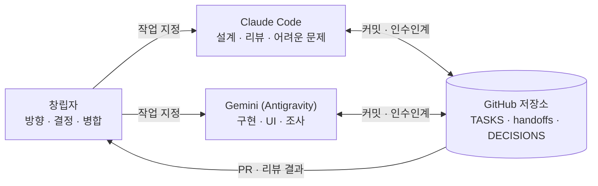

# 원대 (가칭)

> **선언하라! 행동하라! 달성하라!**
>
> 누군가 선언하면, 우리는 비웃지 않는다. 묻는다. **"어떻게?"**

**처음이라면 → [창립자 사용 설명서](docs/00-start-here.md)** (개발 몰라도 됩니다)

원대한 꿈을 진지하게 받아들이는 사람들의 공동체.
한국인의 경쟁 에너지를 옆 사람이 아닌 세계 최전선으로 돌려, 서로 다른 전문가들이 협력해 불가능해 보이는 일에 도전하게 만든다.
펀딩이 아니라 사람과 문화를 만든다. 핵융합과 양자컴퓨터 같은 미래를 **직접 만들 사람들을 만든다.**

---

## 문서 지도

| 문서 | 내용 | 이럴 때 읽는다 |
| --- | --- | --- |
| [선언문](docs/01-manifesto.md) | 우리는 왜 모이는가 | 사람들에게 이 공동체를 설명할 때 |
| [전략](docs/02-strategy.md) | 제로 투 원 원칙으로 짠 단계별 로드맵, 지표, 수익화, 리스크 | 다음에 무엇을 할지 정할 때 |
| [공동체 설계](docs/03-community-design.md) | 다섯 가지 규칙, 질문 사다리, "어떻게의 밤" 진행 대본, 원정대 | 모임을 열 때 |
| [제품 MVP](docs/04-product-mvp.md) | Phase 1에 만들 꿈 아카이브 웹 설계 초안 | 소프트웨어를 만들기 시작할 때 |
| [첫 10명을 찾을 곳](docs/05-first-ten-scouting.md) | 한국 과학 커뮤니티·행사 조사, 첫 연락 메시지 예시 | 사람을 만나러 갈 때 |
| [이름 후보 검토](docs/06-naming.md) | 창립자 후보 평가, 새 후보, 충돌 검사, 추천 | 이름을 정할 때 |
| [꿈 선언서](docs/templates/dream-declaration.md) · [원정대 헌장](docs/templates/expedition-charter.md) | 템플릿 | 꿈을 선언하거나 원정대를 꾸릴 때 |
| [랜딩 페이지](site/index.html) | 선언문 + 꿈 선언서 작성기 | 사람을 모을 때 |

## 창립자가 이번 주에 할 일

소프트웨어보다 사람이 먼저다. → [전략 11장](docs/02-strategy.md#11-지금-당장-할-일)

가장 작은 시장은 **나 자신**이다. 내가 먼저 선언하고, 행동하고, 달성한다.

1. 처음 한 번 설정 (5분) → [사용 설명서 1장](docs/00-start-here.md#1-처음-한-번-설정-5분), T-010
2. 이름 정하기 → [이름 후보 검토](docs/06-naming.md), T-001
3. 나의 꿈 선언서 쓰고, 90일 공개 도전 시작하기 → T-002, T-009
4. 과학 커뮤니티에서 사람 만나기 → [첫 10명을 찾을 곳](docs/05-first-ten-scouting.md), T-003

---

## AI 협업 방식: Claude + Gemini

AI끼리는 직접 대화할 수 없다. 그래서 **이 저장소가 둘 사이의 우체통**이 된다.
창립자는 작업을 지정하고 병합을 결정하는 지휘자 역할을 한다.

| 파일 | 역할 |
| --- | --- |
| [`AGENTS.md`](AGENTS.md) | 모든 AI가 따르는 단일 규칙 원천 |
| [`CLAUDE.md`](CLAUDE.md) / [`GEMINI.md`](GEMINI.md) | 각 AI 전용 메모 (AGENTS.md를 불러온다) |
| [`ai/TASKS.md`](ai/TASKS.md) | 작업 보드: 누가, 무엇을, 어떤 상태로 |
| [`ai/handoffs/`](ai/handoffs/) | 인수인계: 작업이 끝날 때마다 파일 하나 |
| [`ai/DECISIONS.md`](ai/DECISIONS.md) | 결정 기록: AI는 제안하고 사람이 확정한다 |
| [`ai/PROMPTS.md`](ai/PROMPTS.md) | 창립자가 복사해서 쓰는 프롬프트 |

### 하루 흐름 예시

1. **Antigravity(Gemini)**: `ai/PROMPTS.md` 1번 프롬프트로 T-005(랜딩 페이지 QA) 시작 → 구현 → 인수인계 파일 작성 → 푸시
2. **Claude Code**: 3번 프롬프트로 T-005 교차 리뷰 → `ai/reviews/T-005.md`에 결과
3. **Antigravity(Gemini)**: 4번 프롬프트로 리뷰 반영
4. **창립자**: PR 병합, `ai/TASKS.md` 상태를 `done`으로

### Claude 사용량 아끼는 법

- **역할 분담**: Claude는 설계·리뷰·어려운 문제, Gemini는 분량이 많은 구현. 큰 작업은 Claude에게 "쪼개기"만 시키고 구현은 Gemini에게 준다 (`ai/PROMPTS.md` 6번).
- **짧은 시작**: 매 세션 `AGENTS.md` + 최근 인수인계 파일 하나 + 해당 작업 파일만 읽게 한다. 저장소 전체를 읽히지 않는다.
- **한 세션 = 한 작업**: 끝날 때 인수인계를 남기면 어느 AI로든 바로 교대할 수 있다. 사용량이 바닥나도 맥락이 사라지지 않는다.
- **리뷰는 diff로**: 리뷰할 때 전체 코드가 아니라 바뀐 부분과 인수인계 파일만 보게 한다.

### Claude를 내 컴퓨터에서 쓰기

데스크톱 앱의 Code 탭에서 저장소 폴더를 열면 된다. → [사용 설명서 6장](docs/00-start-here.md#6-내-컴퓨터로컬에서-claude-쓰기)
같은 폴더에서 Claude와 Gemini를 동시에 돌리지 않는다. 번갈아 쓴다.

### Antigravity에서 시작하기

1. Antigravity 에이전트에게 `ai/PROMPTS.md`의 **0번 프롬프트**를 붙여 넣는다. 저장소 내려받기와 GitHub 로그인을 에이전트가 단계별로 안내한다.
2. 그다음부터는 1번 프롬프트로 작업을 시킨다. `GEMINI.md`가 자동으로 읽히지 않더라도 프롬프트 첫 줄이 `AGENTS.md`를 읽게 한다.

---

## 랜딩 페이지

### 미리보기

`site/index.html`을 브라우저로 열면 된다. 빌드 과정이 없는 파일 하나짜리 페이지다.

### 배포

GitHub Pages로 자동 배포한다 (`.github/workflows/deploy-site.yml`). `site/`가 바뀌어 `main`에 합쳐질 때마다 갱신된다.

- 켜는 법: 저장소를 공개로 바꾸고 Pages를 켠다 → [사용 설명서 1장](docs/00-start-here.md#1-처음-한-번-설정-5분)
- 저장소가 비공개인 동안에는 배포 작업이 자동으로 건너뛰어진다 (무료 플랜의 Pages는 공개 저장소에서만 동작).
- 주소: https://jeondusan-cloud.github.io/quant/
- 참가 신청 폼이 생기면 `site/index.html` 아래쪽 `CONFIG.joinUrl`에 주소를 넣는다. (T-004)
